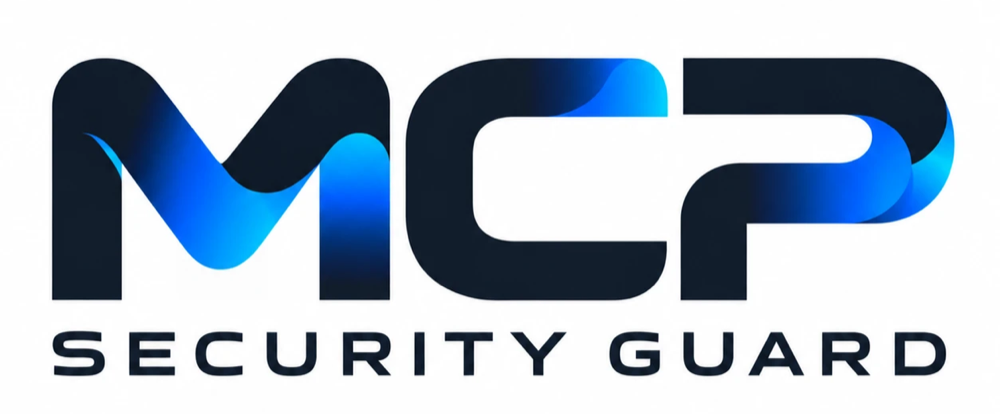

# MCP Security Guard

<p align="center"></p>

**Find out if the MCP servers you installed are lying to your AI.**

Local audit for tool poisoning, rug pulls, tool shadowing, hidden Unicode and leaked secrets, mapped to the OWASP MCP Top 10. Nothing leaves your machine unless you opt in.

[](https://www.npmjs.com/package/mcp-security-guard)
[](https://www.npmjs.com/package/mcp-security-guard)
[](https://glama.ai/mcp/servers/petrovicistefan/mcp-security-guard)
[](https://github.com/petrovicistefan/mcp-security-guard/actions/workflows/ci.yml)
[](https://opensource.org/licenses/MIT)
[](https://owasp.org/www-project-mcp-top-10/)

---

## 🚀 Quick Install

### Cursor

[](https://cursor.com/en/install-mcp?name=mcp-security-guard&config=eyJjb21tYW5kIjoibnB4IiwiYXJncyI6WyIteSIsIm1jcC1zZWN1cml0eS1ndWFyZCJdfQo=)

Click the button above, or use this deep link: `cursor://anysphere.cursor-deeplink/mcp/install?name=mcp-security-guard&config=eyJjb21tYW5kIjoibnB4IiwiYXJncyI6WyIteSIsIm1jcC1zZWN1cml0eS1ndWFyZCJdfQo=`

Or manually add to `.cursor/mcp.json`:

```json
{
  "mcpServers": {
    "mcp-security-guard": {
      "command": "npx",
      "args": ["-y", "mcp-security-guard"]
    }
  }
}
```

### Claude Code

#### Via Plugin (recommended)

```
/plugin marketplace add petrovicistefan/mcp-security-guard
/plugin install mcp-security-guard@mcp-security-guard
```

Then run `/mcp-audit` or ask Claude *"are my MCP servers safe?"*

#### Via CLI

```bash
claude mcp add mcp-security-guard -- npx -y mcp-security-guard
```

### Claude Desktop

Add to your Claude Desktop config (`~/Library/Application Support/Claude/claude_desktop_config.json` on macOS, `%APPDATA%\Claude\claude_desktop_config.json` on Windows):

```json
{
  "mcpServers": {
    "mcp-security-guard": {
      "command": "npx",
      "args": ["-y", "mcp-security-guard"]
    }
  }
}
```

### VS Code

[](https://insiders.vscode.dev/redirect/mcp/install?name=mcp-security-guard&config=%7B%22command%22%3A%22npx%22%2C%22args%22%3A%5B%22-y%22%2C%22mcp-security-guard%22%5D%7D)

Click the button above, or manually add to `.vscode/mcp.json`:

```json
{
  "mcpServers": {
    "mcp-security-guard": {
      "command": "npx",
      "args": ["-y", "mcp-security-guard"]
    }
  }
}
```

### Command Line

```bash
npx -y mcp-security-guard audit --project-only
```

**⭐ Star this repository to support the project and stay updated!** → [Give a star](https://github.com/petrovicistefan/mcp-security-guard)

---

## 📋 Table of Contents

- [Why MCP Security Guard?](#why-mcp-security-guard)
- [Use Cases](#use-cases)
- [What It Checks](#what-it-checks)
- [OWASP MCP Top 10 Coverage](#owasp-mcp-top-10-coverage)
- [Quick Demo (1 Minute)](#quick-demo-1-minute)
- [Tools](#tools)
- [CI / GitHub Action](#ci--github-action)
- [Interactive Dashboard](#interactive-dashboard)
- [Runtime Hooks](#runtime-hooks)
- [Team Plan](#team-plan-paid-opt-in)
- [Benchmark Results](#benchmark-results)
- [Development](#development)
- [Contributing](#contributing)
- [Security & Privacy](#security--privacy)
- [About the Author](#about-the-author)

---

## Why MCP Security Guard?

Your code is covered by other tools. **This one checks the MCP servers that inject text into your AI's context.**

MCP Security Guard audits every MCP server Claude (and other AI clients) can reach: servers you configured, servers that plugins bring, and servers from Claude Desktop and other clients on your machine.

### How It Compares

*As of October 2026. Corrections welcome.*

| Feature | MCP Security Guard | snyk/agent-scan | cisco-ai-defense/mcp-scanner | riseandignite/mcp-shield |
|---------|-------------------|-----------------|------------------------------|-------------------------|
| **Claude Code native plugin** | ✅ | ❌ | ❌ | ❌ |
| **Runtime hooks** (pre/post tool-use) | ✅ | ❌ | ❌ | ❌ |
| **Rug-pull pinning** (SHA-256) | ✅ Tools, skills, CLAUDE.md | Limited | ❌ | ❌ |
| **OWASP MCP Top 10 mapping** | ✅ Every finding | ❌ | ❌ | ❌ |
| **SARIF output** | ✅ GitHub Action | ❌ | ❌ | ❌ |
| **CycloneDX BOM export** | ✅ Agent inventory | ❌ | ❌ | ❌ |
| **Fully local** (zero network) | ✅ Default | Varies | Varies | Varies |
| **Supply-chain checks** | ✅ OSV, npm, PyPI | Varies | Varies | Varies |
| **Tool poisoning detection** | ✅ 26/27 attacks | Varies | Varies | Varies |
| **License** | MIT | Apache 2.0 | MIT | MIT |

**Our differentiators:**
- **Native Claude Code integration** with a `/mcp-audit` slash command and runtime protection
- **Comprehensive rug-pull protection**: pins and verifies tool definitions, skills, commands, subagents, and CLAUDE.md files
- **Every finding mapped to OWASP MCP Top 10** for compliance and remediation guidance
- **GitHub Action with SARIF** for code scanning alerts on pull requests
- **Agent Bill of Materials (BOM)** in CycloneDX 1.6 format for audits and compliance
- **Privacy-first**: everything runs locally by default; network access is explicit opt-in

---

## Use Cases

### 1. Individual Developers

**Protect your local AI setup.**

- Audit MCP servers before and after installation
- Get warned if a server's tool definitions change (rug pulls)
- Runtime protection: block credentials from being sent, detect poisoned outputs
- Pin trusted servers and skills for continuous verification

```bash
# Scan before installing a new server
npx mcp-security-guard scan server-config.json --confirm-launch

# Pin your reviewed servers
npx mcp-security-guard pin

# Check everything is still safe
npx mcp-security-guard audit
```

### 2. Pull Request CI Checks

**Block risky MCP servers and poisoned skills in code review.**

Fail PRs that add:
- MCP servers with tool poisoning, unpinned packages, or privileged Docker images
- Skills or CLAUDE.md files with instruction overrides or credential exfiltration
- Vulnerable dependencies or typosquatted packages

Findings appear in GitHub's code scanning interface with OWASP MCP Top 10 references.

```yaml
- uses: petrovicistefan/mcp-security-guard@main
  with:
    fail-on: high
```

### 3. Teams and Enterprises

**Central security policy for your organization.**

With the [Team plan](#team-plan-paid-opt-in):
- Admins publish one policy (allowed/blocked servers, plugins, pinned versions)
- Everyone's plugin enforces it automatically, even offline
- Approval flow: developers request, admins approve
- Fleet inventory: see what MCP servers your team runs (opt-in with consent)
- Compliance evidence: OWASP MCP Top 10 coverage report for audits

---

## What It Checks

MCP Security Guard discovers servers from every place AI clients load them: user, local and project scope, **servers shipped inside installed plugins**, `claude_desktop_config.json`, Claude Desktop extensions, organization-managed `managed-mcp.json`, **other clients on the machine (Cursor, VS Code, Windsurf)**, and **claude.ai connectors** you've used.

It scans everything a server puts into the AI's context: **tools, server instructions, prompts, resources and resource templates**.

| Check | What It Catches |
|-------|-----------------|
| **Tool poisoning** | Instruction overrides, "don't tell the user", `<IMPORTANT>` tags, directives to read secrets (`~/.ssh`, `.env`), conversation harvesting, exfiltration via URLs/parameters/Markdown images, HTML comments, encoded payloads |
| **Full-schema poisoning** | Same checks on parameter names, descriptions, defaults, enums, `required`, plus non-schema text in `type` |
| **Hidden text** | Zero-width, bidi-control and Unicode-tag characters, ANSI terminal escapes, homoglyph tool names |
| **Tool shadowing** | Server descriptions referencing another server's tools, tool-name collisions between servers |
| **Rug pulls** | Tool definitions or launch commands that changed after you pinned them (SHA-256 per tool). Skills, commands, subagents, CLAUDE.md and hooks of a plugin that changed after pinning (plugins changing files under the same version are flagged `high`). Re-checked automatically at every session start |
| **Capabilities & score** | Per-tool classification (execute, delete, write, egress), unauthenticated remote write access, 0–100 score and A–F grade per server, recommended permission rules |
| **Supply chain** | OSV vulnerabilities and malicious versions, typosquats, missing or brand-new packages, install scripts, publisher changes (opt-in network check) |
| **Runtime** | Hooks on every MCP call: ask before credentials are sent, warn on injected instructions or credentials in outputs, content-free audit log |
| **Policy** | `.mcp-security.json` approved/blocked servers and hosts, enforced in audits, CI and at session start |
| **Toxic flows** | Servers holding all three legs of the "lethal trifecta" (untrusted input, private data, egress capability), on their own or together. A posture note (`low` or `info`), not a defect |
| **Agent context** | Skills and their scripts, slash commands, subagents, rules, `CLAUDE.md` and plugin hooks: instruction overrides, "don't tell the user", invisible text, HTML comments addressed to the model, directives to read credential files, commands that upload credentials, download-and-run, encoded execution, infostealer scripts, pre-approved unrestricted `Bash` |
| **Configuration** | Plaintext secrets in env/headers/args/URLs, plain-HTTP remotes, unpinned `npx`/`uvx` packages, privileged or unpinned Docker images, pipe-to-shell launches, duplicate names across scopes |

**Everything runs locally. Nothing is sent anywhere unless you opt in.**

---

## OWASP MCP Top 10 Coverage

Every finding is tagged with its [OWASP MCP Top 10](https://owasp.org/www-project-mcp-top-10/) id, in reports and in SARIF.

| ID | Risk | Coverage |
|----|------|----------|
| **MCP01** | Token Mismanagement & Secret Exposure | ✅ Plaintext secrets in env, headers, args and URLs. At runtime, asks before a credential is sent to an MCP server and warns when one comes back |
| **MCP02** | Privilege Escalation via Scope Creep | ✅ Capability inventory (execute, delete, write, egress), ready-to-paste `permissions.ask` rules, privileged or broadly mounted containers |
| **MCP03** | Tool Poisoning | ✅ 26/27 published techniques detected, including full-schema poisoning, shadowing and name collisions, plus rug-pull pinning |
| **MCP04** | Supply Chain Attacks | ✅ Unpinned packages, images and git sources; OSV vulnerabilities and malicious versions; typosquats; new packages; install scripts; publisher changes |
| **MCP05** | Command Injection & Execution | ✅ Flags tools that can execute commands; `adversarial_test` finds injectable parameters in servers you own |
| **MCP06** | Prompt Injection via Contextual Payloads | ✅ In tool metadata and, at runtime, in tool outputs (English patterns) |
| **MCP07** | Insufficient AuthN/AuthZ | ✅ Plain-HTTP remotes; remote servers exposing write or exec tools without authentication; OAuth detection |
| **MCP08** | Lack of Audit and Telemetry | ✅ Local, content-free audit log of every MCP call, with `query_audit_log` |
| **MCP09** | Shadow MCP Servers | ✅ Discovery across user, project, local, plugin and Claude Desktop configs; approved-server policy enforced in audits, CI and at session start |
| **MCP10** | Context Injection & Over-Sharing | ✅ Conversation and system-prompt harvesting, Markdown-image exfiltration, credentials in outputs, network-egress inventory |

**What a local tool cannot do** (planned for hosted Team plan): org-wide discovery and audit aggregation, OAuth scope review.

---

## Quick Demo (1 Minute)

Try a synthetic offline comparison with no dependencies, account, or API key needed:

```bash
git clone https://github.com/petrovicistefan/mcp-security-guard.git
cd mcp-security-guard
node scripts/offline-demo.mjs
```

The demo checks two saved tool descriptions: one produces instruction-override and sensitive-path findings; the clean counterpart produces no findings. [Run the scans yourself and generate an HTML report](examples/offline-demo/README.md).

---

## Tools

| Tool | Network | Launches | Description |
|------|---------|----------|-------------|
| `list_mcp_servers` | ❌ | ❌ | Lists every MCP server configured for this project (user, local and project scope in Claude Code, plus Claude Desktop) with its transport. Read-only; launches nothing. |
| `audit_mcp_config` | ❌ | ❌ | Static audit of MCP server configuration: plaintext secrets in env/headers/args/URLs, plain-HTTP remote servers, unpinned npx/uvx packages, unpinned or privileged Docker containers, pipe-to-shell launch commands, and duplicate server names. Read-only; launches nothing. |
| `audit_server_tools` | ❌ | ✅ Confirm | Connects to selected MCP servers, lists their tools, and checks every name, description and schema for tool poisoning, cross-server tool shadowing, and rug pulls. Never calls the scanned tools. Requires `confirm_launch: true`. |
| `pin_tools` | ❌ | ✅ Confirm | Records a SHA-256 hash of every tool definition in `~/.claude/mcp-security/pins.json` for rug-pull detection. Pin only after reviewing an audit. Requires `confirm_launch: true`. |
| `audit_agent_context` | ❌ | ❌ | Scans CLAUDE.md, skills, slash commands, subagents, rules and plugin hooks for instruction overrides, requests to hide things from users, invisible text, credential exfiltration, and encoded execution. Read-only; launches nothing. |
| `pin_context` | ❌ | ❌ | Records SHA-256 of every skill, command, subagent, rule, CLAUDE.md and plugin hook config in `~/.claude/mcp-security/context-pins.json` for rug-pull detection in plugins. Pin only after reviewing an audit. |
| `analyze_tool_definitions` | ❌ | ❌ | Offline analysis of tool definitions you provide (e.g., `tools/list` output from a server you're developing). Useful in CI or before publishing. Never connects to anything. |
| `check_supply_chain` | ✅ Confirm | ❌ | For npx/uvx servers, checks packages on npm/PyPI and OSV database: vulnerabilities, malicious versions, typosquats, install scripts, deprecation, publisher changes. Sends package names and versions only. Requires `confirm_network: true`. |
| `apply_fixes` | Conditional | Conditional | Fixes findings in project files: adds `permissions.ask` rules (needs `confirm_launch`), pins unpinned packages (needs `confirm_network`), or replaces literal secrets with `${VAR}` references. Dry run by default; backs up files before writing. |
| `security_dashboard` | ❌ | Conditional | Opens interactive dashboard with scores, grades, findings by severity, OWASP MCP Top 10 breakdown, and pin buttons. `scan="config"` is read-only; `scan="full"` requires `confirm_launch: true`. MCP App hosts render it inline. |
| `generate_policy` | ❌ | ❌ | Returns a `.mcp-security.json` policy that approves exactly the currently configured servers. Commit it to flag shadow servers in CI and audits. Read-only; does not write the file. |
| `team_status` | ✅ Confirm | ❌ | Syncs organization policy from team backend and shows org name, role, policy version, and fleet reporting status. Requires team API key and `confirm_network: true`. |
| `request_approval` | ✅ Confirm | ❌ | Creates an approval request for a blocked server or plugin when the team policy requires it. Admin decides via CLI. Requires `confirm_network: true`. |
| `team_report` | ✅ Confirm | ❌ | Shows what a fleet report would send (server/plugin names, versions, transports; never paths, args, env, secrets). With `confirm_send: true`, sends it if admin enabled fleet visibility. |
| `export_bom` | ❌ | ❌ | Agent bill of materials: inventory of MCP servers, plugins, skills, commands, subagents, CLAUDE.md and hooks with SHA-256, pin status, scores and OWASP evidence. CycloneDX 1.6 JSON or Markdown summary. Static; launches nothing. |
| `query_audit_log` | ❌ | ❌ | Summarizes the local runtime audit log: MCP tool calls per server/tool, and calls where credentials were sent/returned or outputs contained injected instructions. Log stores hashes and sizes only, never arguments or outputs. |
| `adversarial_test` | ❌ | ✅ Confirm | **Calls tools** with command-injection and path-traversal payloads to find vulnerable parameters. Only for servers you own/operate. Requires `i_own_this_server: true` and `confirm_launch: true`. Destructive tools skipped by default. |

---

## CI / GitHub Action

Fail pull requests that add risky MCP servers to `.mcp.json`, and show findings in GitHub code scanning:

```yaml
name: MCP security
on: [pull_request]
permissions:
  contents: read
  security-events: write
jobs:
  audit:
    runs-on: ubuntu-latest
    steps:
      - uses: actions/checkout@v4
      - uses: petrovicistefan/mcp-security-guard@main
        id: mcp
        with:
          fail-on: high          # critical | high | medium | low | info | none
      - uses: github/codeql-action/upload-sarif@v3
        if: always()
        with:
          sarif_file: ${{ steps.mcp.outputs.sarif-file }}
```

To also fail PRs that add poisoned skills, commands or `CLAUDE.md`, set `context: true` (second SARIF file in `context-sarif-file`).

**Command line:**

```bash
# Audit project-level MCP servers
npx mcp-security-guard audit --project-only --format sarif --output mcp.sarif

# For MCP server authors: analyze a saved tools/list result
npx mcp-security-guard analyze-tools tools.json --name my-server

# Scan skills, commands, subagents and CLAUDE.md
npx mcp-security-guard audit-context --project-only --fail-on high

# Pin what you've reviewed
npx mcp-security-guard pin-context

# Scan a server before installing it
npx mcp-security-guard scan server-config.json --confirm-launch

# Test your own server for command injection (calls tools)
npx mcp-security-guard adversarial my-server.mcp.json --server my-server --i-own-this-server --confirm-launch

# Fix what the audit found
npx mcp-security-guard fix --pin-versions            # npx pkg → pkg@x.y.z
npx mcp-security-guard fix --env-refs --write        # secrets → ${VAR} references
npx mcp-security-guard fix --permissions --confirm-launch --write

# Generate a team policy from current configuration
npx mcp-security-guard policy-init && git add .mcp-security.json
```

**Output formats:** `--format markdown|json|sarif|html` (HTML is a self-contained report file).

**Exit codes:** `0` clean, `1` findings at or above `--fail-on`, `2` usage error.

---

## Interactive Dashboard

`security_dashboard` is an [MCP App](https://modelcontextprotocol.io/docs/extensions/apps) that hosts supporting MCP Apps (Claude Desktop, claude.ai, VS Code Copilot) render inline.

Shows every server with its score and grade, findings filterable by severity and server, OWASP MCP Top 10 breakdown, recommended permission rules, and **Full scan** and **Pin** buttons.

To use in Claude Desktop:

```json
{
  "mcpServers": {
    "mcp-security-guard": {
      "command": "node",
      "args": ["/path/to/mcp-security-guard/plugin/dist/index.mjs"]
    }
  }
}
```

Ask Claude to *"open the MCP security dashboard"*.

Develop locally: `npm run dashboard:dev -- /path/to/project`

---

## Runtime Hooks

| Hook | What It Does | Setting |
|------|-------------|---------|
| `PreToolUse` on `mcp__*` | Asks for confirmation when arguments contain credentials | `MCP_SECURITY_SECRET_GUARD=ask` (default), `deny`, or `off` |
| `PostToolUse` on `mcp__*` | Warns when output contains injected instructions, hidden characters, exfiltration markup, or credentials | Always on |
| Audit log | `~/.claude/mcp-security/audit.jsonl`: server, tool, time, input hash and sizes. Never arguments or outputs. Rotates at 10 MB | `MCP_SECURITY_AUDIT_LOG=off` to disable |

Hooks add ~40ms per MCP call.

**Session-start check** re-verifies pinned servers and stays silent unless something changed:

- `MCP_SECURITY_SESSION_CHECK=full` (default): compare configs and re-list tools
- `MCP_SECURITY_SESSION_CHECK=config`: compare configs only, launch nothing
- `MCP_SECURITY_SESSION_CHECK=off`: disable

---

## Team Plan (paid, opt-in)

Team keys are issued by hand for now: [write to me](mailto:hello@petrovicistefan.ro).

With a team API key (`MCP_SECURITY_API_KEY` or plugin key setting), you get:

- **Central policy** pushed by admin, enforced next to user/project policy (repository cannot loosen it)
- **Approved plugins** (`allowedPlugins`, `blockedPlugins`) enforced in audits, CI, and at session start
- **Fleet inventory** (opt-in with consent): names, versions, scopes, transport, packages/hostnames — never paths, args, env, secrets
- **Approval flow**: `team request`, `team approve`, Slack-compatible webhook alerts
- **Keys and seats**: admin creates/revokes per-developer keys; purchase sets seat limit
- **Web dashboard** at `/v1/team/dashboard`: fleet, approvals, policy, keys, settings
- **Email alerts** (up to 20/hour per org) next to webhook
- **Compliance evidence**: `team compliance` writes Markdown report with OWASP MCP Top 10 controls, evidence, violations, and pending approvals

**Admin actions are CLI only** (not MCP tools), so injected text cannot trigger them.

```bash
mcp-security-guard team status
mcp-security-guard team report --dry-run
mcp-security-guard team request plugin some-plugin --note "for docs site"
mcp-security-guard team approvals --status pending      # admin
mcp-security-guard team approve apr_… --note ok         # admin
mcp-security-guard team policy-push policy.json         # admin
mcp-security-guard team keys create ana                 # admin
mcp-security-guard team settings --fleet on --webhook https://hooks.slack.com/… --email alerts@acme.example
```

Everything above stays free. Free plugin is fully functional. See [PRIVACY.md](PRIVACY.md) for what is sent.

---

## Benchmark Results

**Measured:** detects **26/27 attacks** from a corpus of publicly documented techniques, with **0 false positives** on 13 hard benign samples and on 17 real servers (83 tools).

Techniques covered: tool poisoning and `<IMPORTANT>` tags (Invariant Labs), line jumping and ANSI escape deception (Trail of Bits), full-schema poisoning (CyberArk), tool shadowing, name collisions, zero-width/Unicode-tag/bidi smuggling, homoglyph names, base64 payloads, HTML comments, exfiltration via URLs/parameters/Markdown images.

See [bench/RESULTS.md](bench/RESULTS.md) for full methodology and results.

---

## Development

```bash
npm install
npm run build      # bundles to plugin/dist/ (committed, so plugin runs without npm install)
npm test
npm run bench      # false-positive gate on real servers (network; Docker images optional)
```

`test/fixtures/poisoned-server.mjs` is a deliberately malicious server used by the end-to-end test.

---

## Contributing

Small, reproducible contributions are welcome: benign regression samples, synthetic detection cases, client configuration tests, and clearer examples.

See [CONTRIBUTING.md](CONTRIBUTING.md) for guidelines.

[Contribution guide](CONTRIBUTING.md) · [Open tasks](https://github.com/petrovicistefan/mcp-security-guard/issues) · [Report a false positive](https://github.com/petrovicistefan/mcp-security-guard/issues/new?template=false-positive.md)

---

## Security & Privacy

- **Found a vulnerability?** See [SECURITY.md](SECURITY.md)
- **What is read, written and sent:** [PRIVACY.md](PRIVACY.md)
- **Changes:** [CHANGELOG.md](CHANGELOG.md)

**Trust model:**
- Read-only (except pin files, audit log, and policy-init)
- Network only with explicit opt-in
- Secrets masked in all output
- Static checks reduce risk but don't prove a server safe

---

## License

MIT License

Copyright (c) 2026 Stefan Petrovici

Permission is hereby granted, free of charge, to any person obtaining a copy
of this software and associated documentation files (the "Software"), to deal
in the Software without restriction, including without limitation the rights
to use, copy, modify, merge, publish, distribute, sublicense, and/or sell
copies of the Software, and to permit persons to whom the Software is
furnished to do so, subject to the following conditions:

The above copyright notice and this permission notice shall be included in all
copies or substantial portions of the Software.

THE SOFTWARE IS PROVIDED "AS IS", WITHOUT WARRANTY OF ANY KIND, EXPRESS OR
IMPLIED, INCLUDING BUT NOT LIMITED TO THE WARRANTIES OF MERCHANTABILITY,
FITNESS FOR A PARTICULAR PURPOSE AND NONINFRINGEMENT. IN NO EVENT SHALL THE
AUTHORS OR COPYRIGHT HOLDERS BE LIABLE FOR ANY CLAIM, DAMAGES OR OTHER
LIABILITY, WHETHER IN AN ACTION OF CONTRACT, TORT OR OTHERWISE, ARISING FROM,
OUT OF OR IN CONNECTION WITH THE SOFTWARE OR THE USE OR OTHER DEALINGS IN THE
SOFTWARE.

See [LICENSE](LICENSE) for the complete license text.

---

## Limitations

Remote servers that require OAuth (most hosted MCP servers) cannot be scanned at the tool level: the scanner cannot reuse Claude Code's tokens. Their configuration is still audited.

---

## About the Author

I'm Stefan Petrovici: passionate about IT, a husband and a father. I built MCP Security Guard on my own. **I'm looking for a job.**

I build web applications end to end—frontend, backend, APIs and deployment—and I'm happy to work on anything else that needs building. This repository shows how I work: tests, CI, careful documentation and attention to security.

I also build WordPress and WooCommerce plugins, available at [pluginsforstores.com](https://pluginsforstores.com).

If your team is hiring, write to me at [hello@petrovicistefan.ro](mailto:hello@petrovicistefan.ro).

---

## ⭐ Support This Project

**Found this useful? [Star this repository](https://github.com/petrovicistefan/mcp-security-guard)!**

A GitHub star helps other developers discover the project and lets you save it for later. Thanks for supporting open source!

---

*MCP Security Guard is not affiliated with Anthropic, Snyk, Cisco, or any other security vendor mentioned in this document.*
